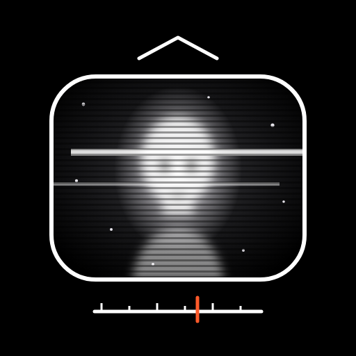

# Belkagraph

Visualizador y compositor de escucha de radio de onda corta para escena.
Parte de la colección **Alchemy of Meaning (Alquimia del Significado)** de
[Héctor Cruz Juárez](https://hectorcruz.com.mx).

Belkagraph escucha una radio —por línea, micrófono, una grabación o la
pestaña de un receptor en línea— y traduce lo que oye en fragmentos de
humanidad: rostros, cuerpos, manos, objetos, signos antiguos, arcanos y
estrellas que cruzan el cuadro una sola vez, hechos de partículas, como una
señal de televisión perdida. No necesita saber la frecuencia sintonizada: todo
nace del sonido. Con estática no aparece nada; cuando la señal se define, las
figuras se forman poco a poco, flotan, giran sobre sus ejes y se deshacen.

Puede además **componer**: una capa sonora procedural escucha la radio y le
responde con un bordón, acordes lentos, campanas, cuerdas, viento y ecos de lo
que se oyó, en un mismo espacio con la señal.

Nació de la escucha con un receptor Belka DX y de la memoria de los grandes
radios de los años setenta y ochenta.

## Usarla

- **En línea:** sube la carpeta a cualquier servidor y ábrela por HTTPS.
- **Instalarla como app:** Chrome o Edge («Instalar Belkagraph»), Safari en
  iPhone o iPad («Agregar a pantalla de inicio») o Chrome en Android. Funciona
  sin conexión después de la primera visita.
- **Local:** abre `index.html` en Chrome o Edge.

Todo vive en un solo archivo (`index.html`, unos 160 KB): no descarga imágenes,
videos ni bibliotecas.

| Tecla | Acción |
| --- | --- |
| V / H | ocultar o mostrar la interfaz |
| 1 2 3 | señal, exposición acumulada, ambas |
| R | otra figura |
| F | película HP5 |
| C | modo de composición: escucha, acompañar, componer |

Las instrucciones completas están en [`LEEME.txt`](LEEME.txt).

## Licencia

Software libre bajo la [GPL-3.0-or-later](LICENSE). © 2026 Héctor Cruz Juárez.
Puedes usarlo, estudiarlo, modificarlo y compartirlo; toda versión derivada que
se distribuya debe conservar esta misma licencia y su código fuente.
