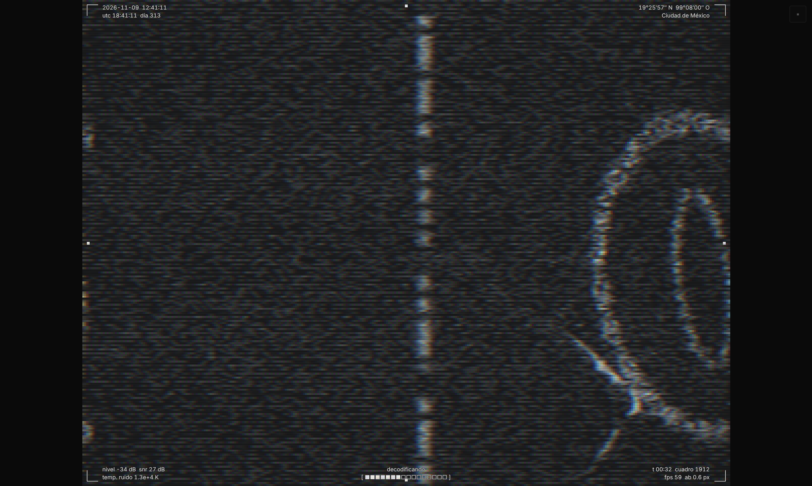
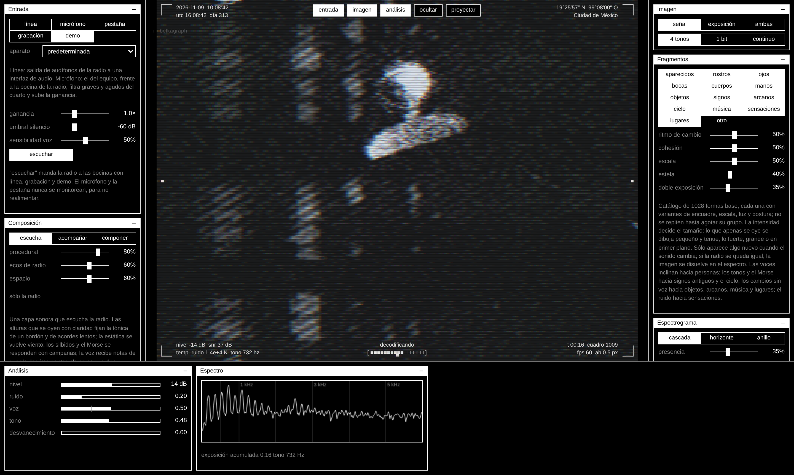
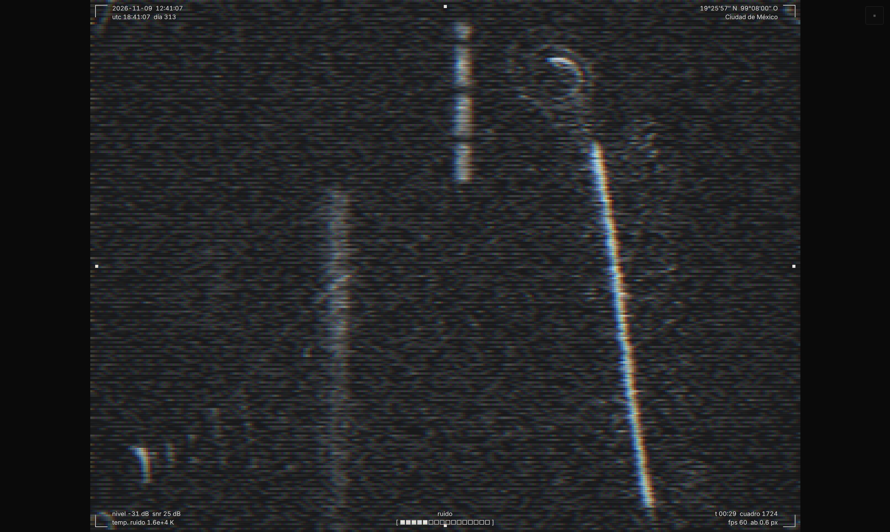
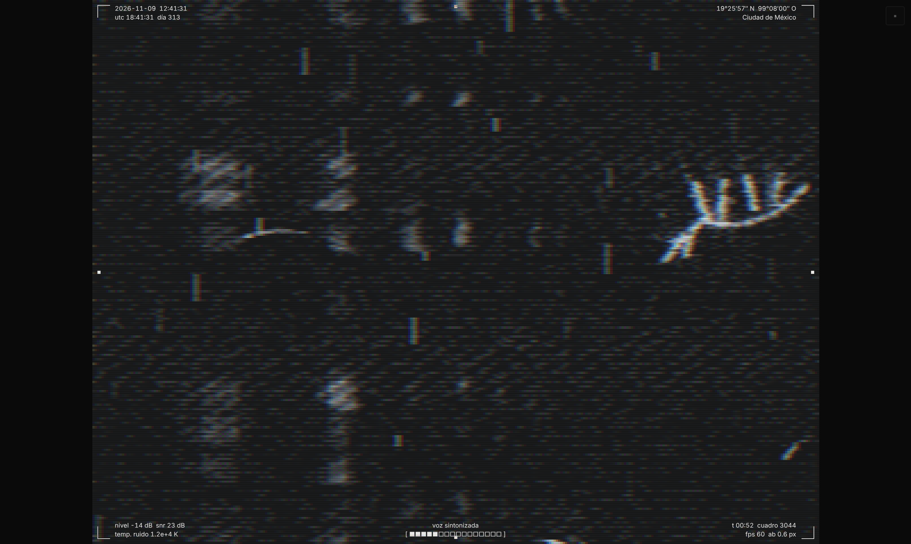
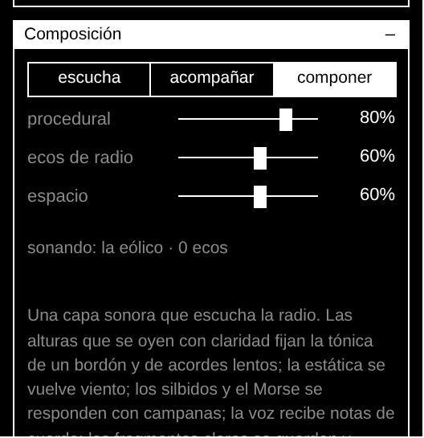
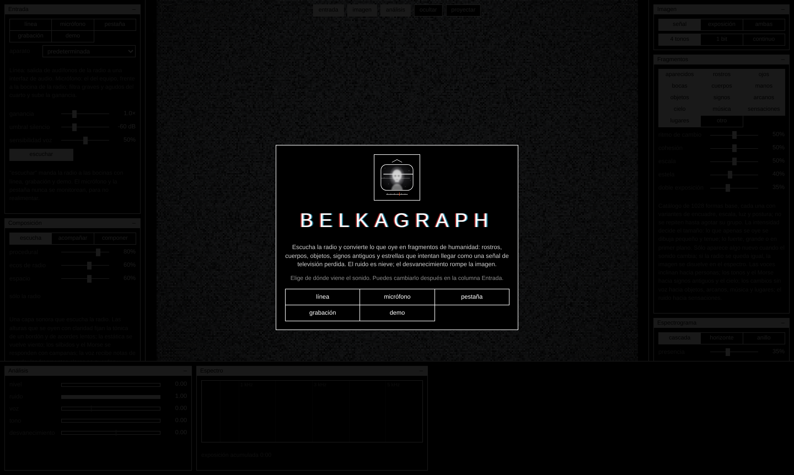

# Belkagraph

**Versión 020 (v020)** · Héctor Cruz Juárez · Alchemy of Meaning

## Español

Belkagraph es un visualizador y compositor de escucha de radio de onda corta para escena. Escucha una radio —por línea, micrófono, una grabación o la pestaña de un receptor en línea— y traduce lo que oye en fragmentos de humanidad: rostros, cuerpos, manos, objetos, signos antiguos, arcanos y estrellas que cruzan el cuadro una sola vez, hechos de partículas, como una señal de televisión perdida.

Nació de la escucha con un receptor Belka DX y de la memoria de los grandes radios de los años setenta y ochenta, cuando sintonizar era buscar voces lejanas entre el ruido.

### Qué hace

**La señal decide qué aparece.** No necesita saber la frecuencia sintonizada: todo nace del sonido. Con estática no aparece nada o apenas un velo; cuando la señal se define, las figuras se forman poco a poco. Las voces inclinan hacia personas, los tonos y el Morse hacia signos antiguos y el cielo, los cambios sin voz hacia objetos, arcanos, música y lugares, y el ruido hacia sensaciones. Ninguna figura se nombra: queda en un territorio ambiguo, para que quien mira complete lo que falta.

**Cada figura pasa una sola vez.** Aparece, flota por un camino curvo, gira sobre su eje y se voltea sobre los otros dos, y se deshace al salir, como la onda que se está escuchando. Mientras una se va, la siguiente llega. Un catálogo de más de mil formas base dibujadas en el momento: no descarga imágenes.

**El espectro dentro de la imagen.** Lo que suena se escribe en la imagen y avanza con el tiempo, en cascada, horizonte o anillo. Las partículas sueltas nacen en las frecuencias que suenan y viajan con él. Encima, película HP5, motion blur, aberración cromática y un marco de datos con hora, coordenadas, nivel, señal/ruido y temperatura de ruido.

**Composición.** Una capa sonora procedural escucha la radio y le responde: las alturas que se oyen con claridad fijan la tónica de un bordón y de acordes lentos, la estática se vuelve viento, los silbidos y el Morse se responden con campanas, la voz recibe notas de cuerda, y los fragmentos claros se guardan y vuelven lentos y lejanos. Tres modos: escucha, acompañar y componer.

**Interfaz de la colección.** Sigue el estilo de Alchemy of Meaning: ventanas pequeñas sobre negro, líneas finas, lecturas con valor real y un solo acento verde para lo que está vivo (la radio sonando, la composición activa, los medidores y el relleno de los deslizadores).

**Para escena.** Pantalla completa sin interfaz, control general de reacción (7% por defecto), exposición acumulada de toda la escucha y guardado del cuadro en PNG. Se instala como app y funciona sin conexión.

### Cómo usarlo

1. Sube la carpeta completa a un servidor con HTTPS, o pruébala en local con `python3 -m http.server 8000` dentro de la carpeta y abre `http://localhost:8000/`.
2. Ábrela en Chrome o Edge y elige la entrada: línea (salida de audífonos de la radio a una interfaz de audio), micrófono frente a la bocina, una grabación o la demo.
3. Para instalarla: «Instalar Belkagraph» en Chrome o Edge, o «Agregar a pantalla de inicio» en Safari. Funciona sin conexión después de la primera visita.
4. El manual completo está en `LEEME.txt`.

| Tecla | Acción |
| --- | --- |
| V / H | ocultar o mostrar la interfaz |
| 1 2 3 | señal, exposición acumulada, ambas |
| R | otra figura |
| F | película HP5 |
| C | composición: escucha, acompañar, componer |

Las capturas se tomaron con la demo en un navegador sin GPU, así que los cuadros por segundo que muestran no reflejan el rendimiento real.

## English

Belkagraph is a shortwave radio listening visualiser and composer for the stage. It listens to a radio —through a line input, a microphone, a recording or the tab of an online receiver— and turns what it hears into fragments of humanity: faces, bodies, hands, objects, ancient signs, arcana and stars that drift across the frame only once, made of particles, like a lost television signal.

It was born from listening with a Belka DX receiver and from the memory of the great radios of the seventies and eighties.

**Features:**

- **The signal decides.** No tuned frequency needed: with static nothing appears; as the signal becomes clear, figures form slowly. Nothing is ever named.
- **Each figure passes once.** It floats along a curved path, turns on its axes and dissolves, while the next one arrives. Over a thousand base shapes drawn live, no image downloads.
- **Spectrum in the image.** A waterfall, horizon or ring of what is sounding, with HP5 film, motion blur, chromatic aberration and a data frame.
- **Composition.** A procedural sound layer listens to the radio and answers it: drone, slow chords, bells, plucked strings, wind and echoes of what was heard.
- **For the stage.** Full screen without interface, master reaction control, accumulated exposure, PNG capture; installable and offline.

**Run it:** serve the folder over HTTPS or `localhost` and open it in Chrome or Edge. The interface and the full manual (`LEEME.txt`) are in Spanish.

## Créditos · Credits

Diseño, investigación y desarrollo: Héctor Cruz Juárez — https://hectorcruz.com.mx  
Colección Alchemy of Meaning.

## Licencia · License

GPL-3.0-or-later. Ver `LICENSE`.
